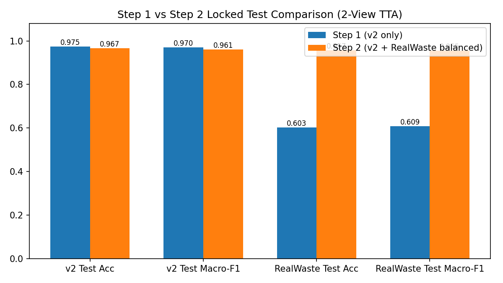
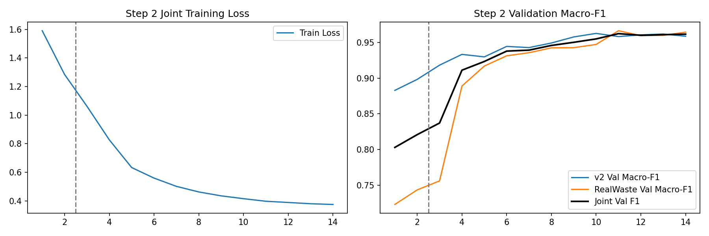
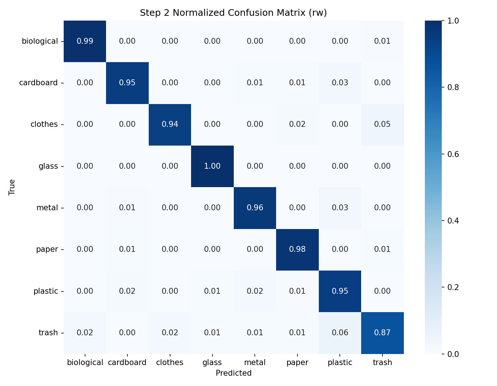
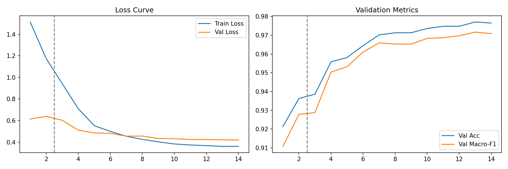
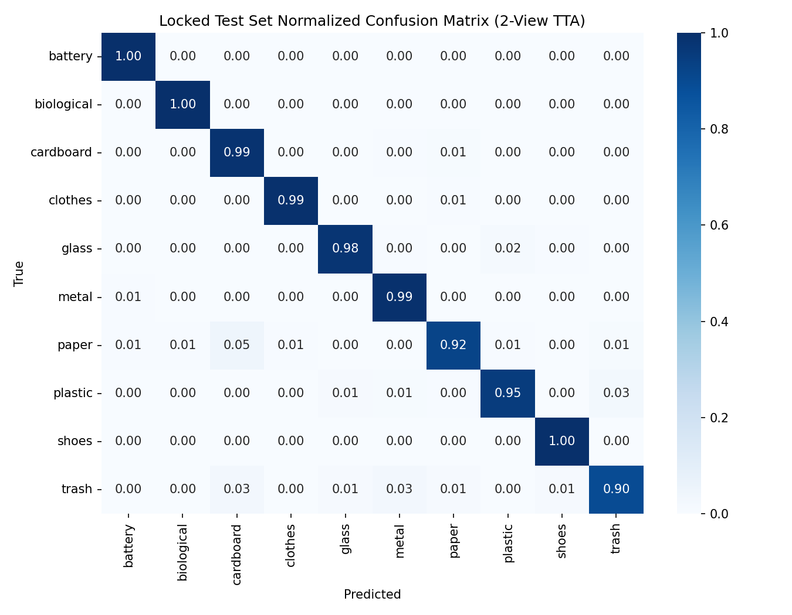

# Garbage Classification Vision (Anti-Leakage Two-Stage Pipeline)

基于 PyTorch + `timm`（ConvNeXt-Tiny）构建的 10 类垃圾视觉分类项目，聚焦解决公开垃圾数据集中的**近重复数据泄漏**与**真实垃圾场域偏移（Domain Gap）**问题。

## 核心亮点

1. **高质量锁定测试集 + 物理隔离（Step 1）**
   - 对全量图像进行损坏校验、MD5 计算与分辨率 / 宽高比 / 曝光 / 对比度 / 拉普拉斯清晰度评估。
   - 使用向量化 64-bit `pHash`（汉明距离 $\le 6$）聚类近重复样本，优先从高质量独立无重复簇中按类别抽样锁定 `test_locked`（`1,817` 张，附带 `test_lock_sha256.txt` 防篡改指纹），并将测试样本及其同簇/边界近重复图从开发池彻底物理剔除。
   - 开发池内仅采用 `StratifiedGroupKFold` 按簇分组切分 `Train / Val`，并通过跨集最小汉明距离断言防火墙（实测最小跨集汉明距离 $= 8 > 6$）。
2. **外部 OOD 诊断 + 跨库受控联合微调（Step 2）**
   - 用真实垃圾场实拍数据集 **RealWaste**（`4,752` 张，8 个重叠类别）做零样本 OOD 评测，量化单库模型在现实脏污场景下掉点至 `60.33%`（`Macro-F1 = 0.6092`）。
   - 在严格复用 Step 1 `v2_test_locked`、独立锁定 `rw_test_locked`（`945` 张）并拦截剔除 `4` 张跨库边界重复样本后，采用 `WeightedRandomSampler`（60% `v2` / 40% `RealWaste` + 类内平方根均衡）联合微调，将真实垃圾场准确率提升 **+35.33 个百分点** 至 **`95.66%`**。

---

## 实验结果总览（2-View TTA）

| 阶段 | 训练数据 | 模型与硬件 | `v2_test_locked` (1,817 张, 10 类) | `RealWaste` (8 重叠类) |
| :--- | :--- | :--- | :---: | :---: |
| **Step 1 (Baseline)** | `garbage-v2` (8,700) | `convnext_tiny.fb_in22k_ft_in1k_384` (L4) | **97.47%** Acc / **0.9697** F1 | 60.33% Acc / 0.6092 F1 *(全量 4,752 张零样本)* |
| **Step 2 (Joint)** | `v2 + RealWaste` (11,877) | `convnext_tiny.fb_in22k_ft_in1k` @ 224 (T4) | **96.70%** Acc / **0.9606** F1 | **95.66%** Acc / **0.9553** F1 *(`rw_test_locked` 945 张)* |

### RealWaste 重叠 8 类 F1-score 逐类提升

| 类别 | Step 1 OOD F1 | Step 2 `rw_test_locked` F1 | 提升幅度 |
| :--- | :---: | :---: | :---: |
| `trash` | 0.2775 | **0.9043** | **+0.6268** |
| `biological` | 0.5507 | **0.9912** | **+0.4405** |
| `clothes` | 0.5607 | **0.9524** | **+0.3917** |
| `cardboard` | 0.5686 | **0.9457** | **+0.3771** |
| `glass` | 0.6718 | **0.9825** | **+0.3107** |
| `paper` | 0.7109 | **0.9703** | **+0.2594** |
| `plastic` | 0.7016 | **0.9348** | **+0.2332** |
| `metal` | 0.8320 | **0.9615** | **+0.1295** |



| 双域联合训练收敛曲线 | `v2` 锁定测试集混淆矩阵 | `RealWaste` 锁定测试集混淆矩阵 |
| :---: | :---: | :---: |
|  |  |  |

| Step 1 训练曲线 | Step 1 `v2` 混淆矩阵 | Step 1 Grad-CAM 注意力可视化 |
| :---: | :---: | :---: |
|  |  |  |

---

## 仓库目录结构

```text
garbage-classification-vision/
├── README.md
├── .gitignore
├── requirements.txt
├── notebooks/
│   └── garbage_classification_step1_colab.ipynb   # Step 1 Colab 交互式完整 Notebook（含 Gradio 演示）
├── scripts/
│   ├── step1_train_colab.py                       # Step 1 无头训练与评测脚本
│   └── step2_train_colab.py                       # Step 2 跨库防泄漏联合训练脚本
└── results/
    ├── step1/                                     # Step 1 指标 JSON、锁指纹、测试集清单与图表
    └── step2/                                     # Step 2 指标 JSON、双域锁指纹、跨库剔除日志与图表
```

---

## 预训练权重下载（GitHub Releases）

模型权重文件（约 106 MB）托管在 [Releases v1.0.0](https://github.com/Hocalors/garbage-classification-vision/releases/tag/v1.0.0)：
- **`best_step2.pt`**（推荐）：`garbage-v2` + `RealWaste` 联合微调权重，真实垃圾场景 `95.66%` / `v2` 域 `96.70%`。
- **`best_step1.pt`**：Step 1 单库 `384×384` 基线权重，`v2_test_locked` 准确率 `97.47%`。

## 快速复现

1. **Colab 交互式运行（含 Gradio Web 演示）**：将 `notebooks/garbage_classification_step1_colab.ipynb` 上传至 Google Colab（GPU 运行时）按顺序执行。
2. **通过 `google-colab-cli` 无头复现**：
   ```bash
   pip install -r requirements.txt
   # 在 Colab GPU 会话上分别执行 Step 1 与 Step 2：
   python scripts/step1_train_colab.py
   python scripts/step2_train_colab.py
   ```
