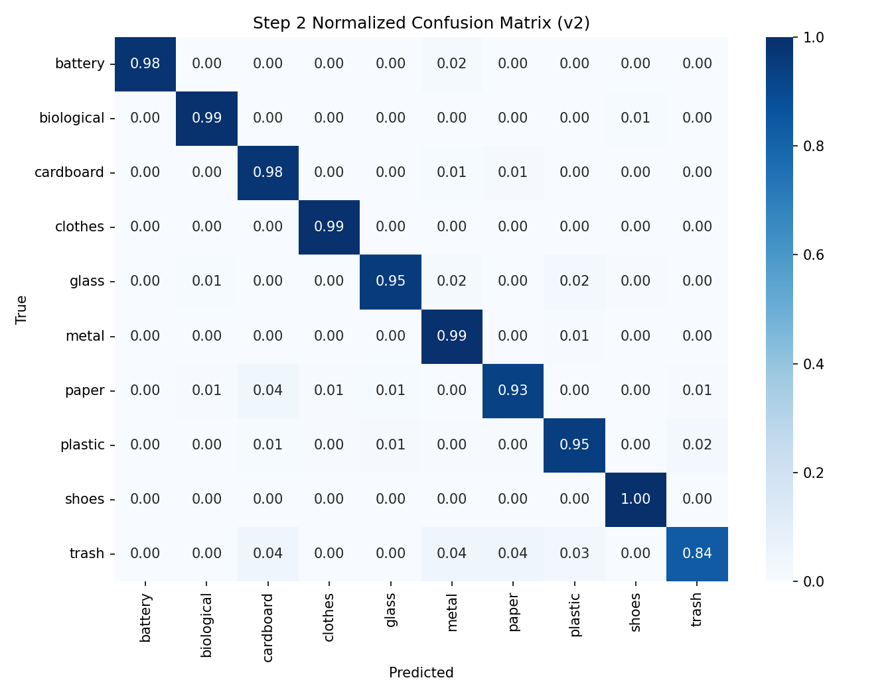
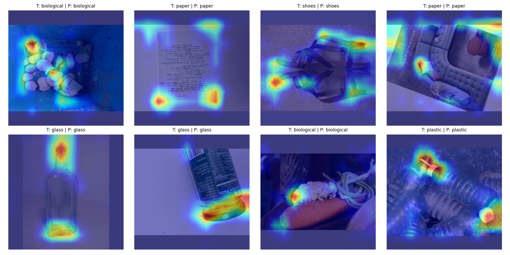

# Garbage Classification Vision (Anti-Leakage Two-Stage Pipeline)

A PyTorch + `timm` (`ConvNeXt-Tiny`) 10-class waste image classification project designed to eliminate **near-duplicate data leakage** and bridge the **real-world landfill domain gap** commonly found in public garbage datasets.

## Key Highlights

1. **High-Quality Locked Test Set & Physical Isolation (Step 1)**
   - Runs a full integrity and visual-quality audit across all images (corrupted-file verification, MD5 hashing, resolution, aspect ratio, brightness/contrast, and Laplacian sharpness).
   - Uses vectorized 64-bit `pHash` clustering (Hamming distance $\le 6$) to group near-duplicates, prioritizes sampling the test set (`test_locked`, 1,817 images, anchored by `test_lock_sha256.txt`) from high-quality singleton clusters, and physically excludes all test images plus any same-cluster or cross-boundary near-duplicates from the development pool.
   - Splits `Train / Val` strictly inside the clean pool via `StratifiedGroupKFold` grouped by `pHash` cluster, guarded by hard assertions (verified minimum cross-boundary Hamming distance $= 8 > 6$).
2. **External OOD Audit & Controlled Cross-Dataset Fine-Tuning (Step 2)**
   - Evaluates zero-shot generalization on **RealWaste** (4,752 real landfill reception images across 8 overlapping classes), exposing a severe domain drop to `60.33%` accuracy (`0.6092` Macro-F1) when training on `garbage-classification-v2` alone.
   - Reuses the exact Step 1 `v2_test_locked` set, locks an independent high-quality `rw_test_locked` set (945 images), removes 4 cross-dataset boundary duplicates via the `pHash` firewall, and trains jointly with `WeightedRandomSampler` (`60% v2 / 40% RealWaste` with inverse square-root class balancing)—boosting RealWaste accuracy by **+35.33 percentage points** to **`95.66%`**.

---

## Experimental Results (2-View TTA)

| Stage | Training Data | Backbone & Hardware | `v2_test_locked` (1,817 imgs, 10 cls) | `RealWaste` (8 overlapping cls) |
| :--- | :--- | :--- | :---: | :---: |
| **Step 1 (Baseline)** | `garbage-v2` (8,700) | `convnext_tiny.fb_in22k_ft_in1k_384` (L4) | **97.47%** Acc / **0.9697** F1 | 60.33% Acc / 0.6092 F1 *(Full 4,752 OOD)* |
| **Step 2 (Joint)** | `v2 + RealWaste` (11,877) | `convnext_tiny.fb_in22k_ft_in1k` @ 224 (T4) | **96.70%** Acc / **0.9606** F1 | **95.66%** Acc / **0.9553** F1 *(`rw_test_locked`, 945 imgs)* |

### Per-Class F1-Score Improvement on RealWaste (8 Overlapping Classes)

| Class | Step 1 Zero-Shot OOD F1 | Step 2 `rw_test_locked` F1 | Gain |
| :--- | :---: | :---: | :---: |
| `trash` | 0.2775 | **0.9043** | **+0.6268** |
| `biological` | 0.5507 | **0.9912** | **+0.4405** |
| `clothes` | 0.5607 | **0.9524** | **+0.3917** |
| `cardboard` | 0.5686 | **0.9457** | **+0.3771** |
| `glass` | 0.6718 | **0.9825** | **+0.3107** |
| `paper` | 0.7109 | **0.9703** | **+0.2594** |
| `plastic` | 0.7016 | **0.9348** | **+0.2332** |
| `metal` | 0.8320 | **0.9615** | **+0.1295** |


| Joint Training Curves (Step 2) | `v2` Locked Test Confusion Matrix | `RealWaste` Locked Test Confusion Matrix |
| :---: | :---: | :---: |
|  |  |  |

| Step 1 Training Curves | Step 1 `v2` Confusion Matrix | Step 1 Grad-CAM Saliency Maps |
| :---: | :---: | :---: |
|  |  |  |

---

## Repository Structure

```text
garbage-classification-vision/
├── README.md
├── .gitignore
├── requirements.txt
├── notebooks/
│   └── garbage_classification_step1_colab.ipynb   # Interactive Step 1 Colab notebook (with Gradio demo)
├── scripts/
│   ├── step1_train_colab.py                       # Headless Step 1 training & evaluation script
│   └── step2_train_colab.py                       # Headless Step 2 cross-dataset joint training script
└── results/
    ├── step1/                                     # Step 1 metrics JSON, SHA256 lock, test manifest & figures
    └── step2/                                     # Step 2 metrics JSON, dual locks, exclusion log & figures
```

---

## Pretrained Checkpoints (GitHub Releases)

Model weights (~106 MB each) are hosted in [Releases v1.0.0](https://github.com/Hocalors/garbage-classification-vision/releases/tag/v1.0.0):
- **`best_step2.pt`** *(Recommended)*: `garbage-v2 + RealWaste` joint checkpoint (`95.66%` on RealWaste / `96.70%` on `v2`).
- **`best_step1.pt`**: Step 1 `v2`-only `384×384` baseline checkpoint (`97.47%` on `v2_test_locked`).

## Quick Start

1. **Interactive Colab Notebook (with Gradio Web Demo)**: Upload `notebooks/garbage_classification_step1_colab.ipynb` to Google Colab with a GPU runtime and run cells sequentially.
2. **Headless Reproduction (via `google-colab-cli` or Colab VM)**:
   ```bash
   pip install -r requirements.txt
   python scripts/step1_train_colab.py
   python scripts/step2_train_colab.py
   ```
